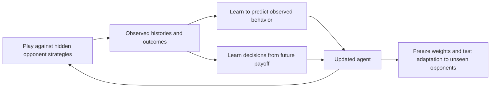

**Learning to discover opponent strategies: prediction, payoff, and adaptation**

Research and implementation plan — 2026-10-16

Status: proposal only. This document does not implement code, change prompts, run evaluations, or establish training results. Repository inspected at `54cf5ed`; `prime-rl` inspected at `ca18e35`. Proposed configuration fields, interfaces, and files below do not exist unless explicitly described as existing.

**The proposed experiment trains an agent to predict what an opponent will do and to use that knowledge to earn future payoff.** The agent observes ordinary game history, generates its own reasoning, and receives no description of the opponent's hidden strategy. Training combines prediction of subsequently observed behavior with reinforcement learning on game outcomes. Across varied opponents, the intended learned behavior is to gather evidence, revise beliefs, and exploit a newly encountered strategy quickly.

The immediate next step is a controlled baseline comparison: the current model under the original prompt versus the same model under a prompt that also requires an opponent prediction. Training begins after this interface and its measurements are reliable. The prediction-enabled untrained model is the principal baseline for trained models.

For a short presentation: “Our current agent sometimes wins by following a pattern that happens to work. We want it to learn how to infer an unfamiliar opponent's behavior from interaction. We will ask it to predict before acting, train predictions using what actually happens, and train decisions using game payoff. We will then test whether it adapts faster to opponents it has not trained against.”

The training and evaluation flow is:



**1. The research claim concerns learning to adapt within a new game.**

During training, model weights change across many games. During evaluation, weights remain frozen; only observed history and private notes accumulate within a game. Improvement means that the trained model uses a few observations more effectively than the original model, rather than needing a weight update for each opponent.

The existing [baseline report](copycat_rps_baseline.md) provides evidence about untrained play. It reports roughly 44–45% wins in rounds 2–10, and 63.8% across rounds 2–100 in the longer greedy run. The inspected traces were interpreted as relying on cycles or recurring phrases, without a reliable explicit statement of the copycat rule. These findings motivate the experiment. Absence of a verbal statement alone does not prove absence of an internal representation.

The report's assertion that RL currently does not improve the model is **unverified for this plan**. No controlled RL comparison in that report establishes it. Outcome-only RL remains an important competing hypothesis. The original report is retained unchanged as the historical record.

In the implemented game, the opponent's move in round `t` equals the player's move in round `t-1`. It does not repeat its own preceding move. Once that rule is known, all rounds after the first can be won. The hidden opening move prevents a guaranteed first-round win. Because a fixed three-move rotation can also win every later round, ordinary copycat performance is insufficient evidence of general strategy discovery.

The current opponent is scripted. This stage studies opponent modeling inside the self-play engine. Training against a population of learned agents is a later extension.

Success will be assessed at three levels:

| Level | Evidence required | Claim supported |
|---|---|---|
| Task improvement | Higher payoff on new episodes of the existing game | Better copycat performance |
| Adaptation | Faster improvement within episodes, recovery after disrupted action sequences, and performance on held-out opponent programs | Better use of interaction history |
| Transfer | Improvement on rule structures or games excluded from training | Broader strategic ability |

All training inputs must exclude private opponent identity, rule descriptions, simulator code, hidden future actions, and future observations. Public rules and information naturally revealed during play remain available. Simulator metadata can be retained outside model inputs for grouping, evaluation, and reproducibility.

**2. Establish an explicit prediction interface before training.**

Introduce a proposed environment option, `prediction_mode`, with values `off` and `opponent_action_v1`. Its default is `off`. The original prompt path should remain byte-for-byte identical when it is off, allowing historical results to remain comparable.

Enable predictions only on move calls (`call="answer"`). Thinking and talk calls retain their current instructions and output format. A prediction is produced in the existing move call, so the number and scheduling of model calls remain unchanged. This also avoids introducing extra inference-time computation through an additional prediction call in the main baseline.

Proposed additional move instruction:

> Before choosing your action, predict the opponent's action for this round using only the information currently available to you. Express your uncertainty as probabilities over the possible opponent actions. Put the probabilities in the prediction field, then choose your action according to the game's stated objective.

For RPS, additionally specify the exact JSON keys `rock`, `paper`, and `scissors`, require finite numeric values between zero and one, and require them to sum to one. Do not mention copying, cycles, lagged dependencies, or any candidate strategy. Preserve the existing public game rules and objective wording in this first comparison.

The move response contract becomes:

```text
<thinking>Private reasoning based on currently available information.</thinking>
<prediction>{"rock": 0.33, "paper": 0.34, "scissors": 0.33}</prediction>
<answer>rock</answer>
[STOP]
```

The numbers illustrate the schema for this document; they are not recommended probabilities or a required numeric example in the production prompt. Use a schema description to avoid unnecessarily anchoring the model to one distribution.

The system prompt must describe the correct format for the active call type. Merely adding a user instruction would conflict with the current system instruction to emit exactly the old two-tag format. For `think` and `talk`, preserve the old system prompt as well as the old user instruction.

Keep prediction output private. Do not add forecasts, forecast scores, or extra reminders to future prompts in the initial comparison. The agent still receives the actual moves through the normal history. Its move-call scratch work remains transient, and only thinking calls rewrite the persistent notes. Changing memory visibility is a separate experiment.

**3. Parse predictions independently from game actions and preserve their provenance.**

Keep the existing `parse_reply()` behavior for thinking and action extraction. Add a separate prediction parser and validator so a malformed prediction cannot silently alter move parsing or force a different action.

Validation should require exactly one top-level prediction block in the specified position before the action answer, valid JSON with exactly the permitted keys, numeric values excluding booleans, finite values in `[0, 1]`, and a sum within a declared tolerance of one. A prediction tag quoted inside scratch work is not a valid top-level forecast. A proposed sum tolerance is `1e-3`. Distributions inside that tolerance may be normalized for scoring, with both the raw values and the normalization recorded. Values outside it are invalid; do not silently repair them or replace them with a uniform forecast.

Record separate statuses such as `valid`, `missing`, `duplicate_block`, `invalid_json`, `invalid_labels`, `invalid_values`, and `invalid_sum`. Parsing duplicate JSON keys should reject them rather than accepting the last value. No prediction is expected in `off` mode or for thinking/talk calls.

In the baseline, an invalid prediction does not trigger a retry, forfeit, or action fallback. Existing handling of invalid game actions remains unchanged. This prevents the added measurement from changing the game mechanics. A strict prediction-format training policy, if later needed, requires a separately documented setting and ablation.

Every model request needs a stable `call_id`, persisted through checkpoint replay. Associate the selected move call with the resulting accepted non-thinking `step_id` and a game-provided decision identifier. Do not infer round number from the total number of engine steps: thinking steps also occupy that sequence.

If action retries are enabled, retain every attempt but score one forecast per executed decision: the forecast from the final move attempt associated with that decision. For an action fallback after exhausted retries, score the last attempt's valid forecast and mark the action as a fallback. Forced engine actions with no model call have no forecast. Main baseline configs retain zero retries.

A conceptual completed decision record is:

```json
{
  "schema_version": 1,
  "call_id": "episode-identifier:call-7",
  "player_id": "player",
  "decision_id": 3,
  "step_id": 5,
  "prediction_target_id": "opponent_action",
  "prediction_raw": "{\"rock\":0.2,\"paper\":0.6,\"scissors\":0.2}",
  "prediction_probs": {"rock": 0.2, "paper": 0.6, "scissors": 0.2},
  "prediction_status": "valid",
  "prediction_normalized": false,
  "observed_target": "paper",
  "executed_action": "scissors",
  "action_source": "model",
  "round_reward": 1.0
}
```

The identifiers and values are illustrative. At call time, persist the forecast and pre-action context. Attach `observed_target`, action, and reward only after the transition reveals them. Preserve the original prompt and reply; never overwrite them with a corrected explanation.

**4. Keep the runner generic by letting games declare prediction targets.**

The engine currently separates game rules from dialogue scheduling. Preserve that boundary. A proposed game interface can expose an optional prediction specification containing a target identifier, a public description, and the possible observable labels. RPS supplies `opponent_action` and its three moves. The generic runner should not contain RPS labels or inspect the private `opponent_move()` result before acting.

A corresponding game adapter resolves the observed target for a completed step using information publicly revealed by that transition. The target can be joined to the stored prediction immediately after the step or during final record construction. Unsupported games return no specification; explicitly enabling this prediction mode for such a game should fail clearly rather than silently omitting it.

These are proposed interface responsibilities, not finalized signatures:

```text
prediction specification(player, current observation)
    -> target id, public description, label set, decision id

resolved prediction target(player, accepted step id)
    -> observed label, or unavailable if not publicly resolved
```

Hidden opponent state is not an acceptable target merely because the simulator can access it. For later partially observable games, predict actions or observations that are actually revealed to the learner. Simultaneous actions must still all be collected before any player's choice is exposed.

Suggested implementation map:

| File or area | Status | Intended change |
|---|---|---|
| [`self_play/prompting.py`](../self_play/prompting.py) | Existing | Select a call-specific response contract while preserving the original `off` path. |
| `self_play/prediction.py` | Proposed | Define prediction data structures, parsing, validation, and scoring helpers. |
| [`self_play/game.py`](../self_play/game.py) | Existing | Add optional prediction-specification and resolved-target hooks with defaults that preserve other games. |
| [`self_play/games/copycat_rps/game.py`](../self_play/games/copycat_rps/game.py) | Existing | Implement the RPS target adapter from public observations and completed rounds. |
| [`self_play/games/copycat_rps/prompts.py`](../self_play/games/copycat_rps/prompts.py) | Existing | Supply the RPS-specific forecast labels and move instruction without describing the opponent policy. |
| [`self_play/runner.py`](../self_play/runner.py) | Existing | Pass prediction mode and call type, persist call IDs, and associate forecasts with executed decisions. |
| [`self_play_verifiers/env.py`](../self_play_verifiers/env.py) | Existing | Expose the mode, pass it into the runner, export per-decision data and aggregate metrics without changing baseline rewards. |
| [`self_play/checkpoint.py`](../self_play/checkpoint.py) and runner snapshots | Existing | Store and validate a run compatibility fingerprint. |
| [`self_play_verifiers/taskset.py`](../self_play_verifiers/taskset.py) | Existing | Later add explicit seed ranges or manifests for disjoint evaluation and training sets. |
| [`scripts/analyze_copycat_games.py`](../scripts/analyze_copycat_games.py) | Existing | Retain legacy summaries; add prediction coverage, proper scores, per-window results, and paired comparisons. |
| `eval_configs/prediction_*.toml` | Proposed | Define prediction-enabled counterparts of the existing baseline configs. |
| `scripts/build_prediction_dataset.py` | Proposed, later | Export pre-action histories and subsequently observed targets with episode/program-level splits. |

Store detailed records under a versioned field such as `trace.info["predictions"]`. Keep aggregate reward channels distinct from prediction metrics. Older traces with no prediction field should load successfully and report those measurements as unavailable.

**5. Version prompts and checkpoints before rerunning the baseline.**

The current checkpoint filename hashes the game name and `game_config`. A completed checkpoint is restored without rerunning its prompts. Therefore changing a prompt or model while reusing a checkpoint directory can return results from a different experimental condition.

Use a fresh run name and checkpoint directory for every condition. Also add a snapshot compatibility fingerprint that includes the prediction protocol version, prompt-template hash, model/checkpoint identity, renderer settings, resolved sampling configuration, and relevant runner settings. Validate it before restoring either partial or finished results. Resume should require exact compatibility; legacy checkpoints without the new metadata need an explicit legacy-compatible path, not automatic reuse for new runs.

The existing `scripts/eval.sh` saves resolved configs and uses one rollout per task. Keep that behavior for evaluation. Its checkpoint mechanism cannot be reused unchanged for multiple GRPO rollouts of the same task: training must keep it disabled or introduce per-rollout checkpoint identities in a separate change.

Run metadata should capture the root and submodule commits, model revision, tokenizer/chat template, prompt version/hash, seed manifest, temperature, top-p, top-k, token limits, stop string, concurrency, retries, prediction tolerance, reward mode, and evaluation code version. Capture effective server defaults as well as client settings. An environment seed is not a substitute for recording model-sampling randomness or nondeterminism.

**6. Rerun a paired, untrained baseline under both interfaces.**

Use the existing Gemma checkpoint for direct comparison with the report. If a smaller model is later used for training, run its own baseline under both interfaces. A trained small model compared only with untrained Gemma would confound model choice with training.

| Condition | Weights | Prompt | Main purpose |
|---|---|---|---|
| B0 | Original checkpoint | Original, prediction off | Historical reference |
| B1 | Same original checkpoint | Prediction enabled | Effect of explicitly forecasting |
| T | Trained checkpoint | Same prediction-enabled prompt | Improvement beyond B1 due to training |

The comparison B1 minus B0 measures the prompt/interface effect. Each trained condition minus B1 measures training improvement. Preserve B0 and B1 after training and evaluate them on newly introduced test suites as well.

Proposed run sequence and budget:

| Stage | Conditions | Episodes per condition | Horizon | Approximate total model calls |
|---|---|---:|---:|---:|
| Smoke | Both prompt modes; include a resumed run | A few | 5–10 | Small correctness check |
| Primary baseline | 2 prompt modes × 2 decoding settings | 100 | 10 | 10,000 |
| Long-game follow-up | 2 prompt modes × 2 decoding settings | 20 | 100 | 20,000 |

Call estimates use the current schedule: `2T + ceil(T/2)` calls per episode, or 25 calls for 10 rounds and 250 for 100. Counts exclude retries, smoke checks, and optional additional sampling replicates. Measure actual input/output tokens and elapsed compute before scheduling the long follow-up. Twenty long episodes provide a diagnostic, not a precise final estimate.

Within each paired comparison, match model weights, seed list, public history, opponent behavior and speech, dialogue schedule, note semantics, retries, context limits, and sampling settings. Use temperature 0 and temperature 1.0 as separate strata. The report used top-k 64 and top-p 0.95 for sampled runs; explicitly resolve and record those settings rather than assuming current server defaults match.

Match completion budgets within horizons: the existing short configs use 2,048 tokens per call and the long configs use 4,096. Measure truncation and generated length. If the prediction field causes truncation, record the finding and repeat both arms with a jointly increased budget; do not quietly give only B1 more capacity.

Retain original game rules, reward settings, and speech in this first experiment. In particular, the opponent's explicit move claim is truthful 50% of the time and carries information. Removing or randomizing it is a separate observation-distribution ablation, not a harmless cleanup.

Use new run names such as `rps-predv1-base-gemma31b-t0-r10-n100`; record every additional setting in the resolved manifest. The proposed TOML addition is `[env] prediction_mode = "opponent_action_v1"`; it is not currently accepted by the code. Existing command shapes in `scripts/eval.sh` can be reused after implementation, with new configs and run directories.

**7. Measure prediction quality, gameplay, and adaptation separately.**

| Metric | Definition or reporting rule |
|---|---|
| Round W/D/L | Report all rounds and rounds 2+ separately. Do not call win-plus-half-draw score a win rate. |
| Mean round payoff | Mean of win = 1, draw = 0.5, loss = 0. |
| Match W/T/L | Preserve the existing whole-game result. |
| Forecast coverage | Valid forecasts / model move decisions; report every invalid status and excluded forced decision. |
| Forecast accuracy | Argmax forecast versus the observed action, with a fixed declared tie-breaking rule. |
| Brier score | `sum_a (p(a) - 1[a = observed])^2`; lower is better, range 0–2 for this three-class convention. Uniform forecasts score 2/3. |
| Forecast log loss | `-log(max(p(observed), 1e-8))`; report the floor and the number of zero-probability observations. |
| Action consistency | Expected-payoff gap between the chosen move and the best move under the declared forecast. Compute the full payoff expectation, not merely the response to the most probable class. |
| Adaptation windows | Rounds 1–5, 6–10, and later 10-round windows where available. |
| Output costs | Input/output tokens, response length, truncation, calls, and wall/GPU time. |
| Existing validity | Invalid game actions and fallbacks, separately from invalid forecasts. |

Compute probability scores on valid forecasts with the denominator and coverage visible. Never drop a game from payoff reporting because its forecasts were invalid. Also report a clearly labeled coverage-adjusted Brier summary that assigns invalid forecasts the worst score of 2; this prevents selective nonprediction from looking successful. It is an operational composite, not a proper probability score for invalid outputs. B0 has no forecast metrics; do not invent predictions for it.

Aggregate per episode and report paired differences for B0/B1 using matched game seeds. Bootstrap whole episodes, not independent rounds. When comparing trained models, separately report variation across training seeds; thousands of rounds from one checkpoint do not replace multiple independent training runs.

Accuracy of explanations or occurrences of the word “copycat” can support qualitative inspection, but must not be the main understanding metric. Prediction and payoff can both be perfect on a fixed rotation, so later adaptation tests are essential.

**8. Build prediction supervision from observed experience.**

After the baseline, generate an initial 10,000–50,000 transition dataset across varied hidden opponents and behavior policies. Include random play, current-policy play, historical-policy play, and exploratory behavior. Restricting collection to successful rotations would preserve the ambiguity the method is supposed to resolve.

Start with a controlled opponent family that varies dependencies on history, internal state, and stochasticity. Sample parameters and initial states independently of visible labels and surface text. Opponent programs and metadata remain outside model inputs. Reserve both new program instances and entire rule structures for evaluation; state clearly which kind of holdout each result uses.

Each supervised example contains only the information available immediately before the target action and the action subsequently observed:

```json
{
  "prompt": "Public history and pre-action notes, followed by a request to predict the next observable opponent action.",
  "completion": "paper",
  "metadata": {
    "episode_id": "...",
    "decision_id": 7,
    "opponent_program_id": "private-analysis-only",
    "behavior_policy_id": "...",
    "source_checkpoint": "...",
    "split": "train"
  }
}
```

This illustrates the data contract; rendering and assistant delimiters depend on the model's verified chat template. Metadata is not serialized into model input. The target is an observed action, not the best response, a rule name, or a synthetic explanation. Do not add a target answer into the history by accident while slicing a finished transcript. Retain the opponent's pre-move public message if it was available in that decision.

Partition by full episode and opponent program before extracting prefixes, then deduplicate. Use explicit seed manifests or ranges; the current taskset starts at zero on every load. Reserve the baseline/development episodes and a separate untouched final test set before training. Do not allow a default taskset restart to place evaluation episodes into the training data.

For stochastic opponents, a single observed action is a legitimate classification target. Across repeated experience, likelihood training can learn uncertainty. Do not convert every observed label into a textual one-hot JSON forecast and teach the model to claim certainty in ambiguous situations.

Keep some transitions from losses and uncertain situations. They are useful predictive evidence even though a filter based solely on winning would discard them. Resolved target labels and summaries must remain based on information available to the agent, not private future simulator state.

**9. Separate reported probabilities from the differentiable training objective.**

The JSON probabilities in B1 are model-declared forecasts, scored with Brier/log loss. They are not automatically the same as the language model's token probabilities. Parsing `0.6` from generated text does not create a differentiable three-class probability head.

The first training implementation should use the existing offline dataset SFT path to teach next-action prediction: supply a pre-action context, ask for the next opponent action, and teacher-force the actual observed action label. Apply cross-entropy to the target completion; mask all prompt tokens. No reasoning demonstration is required.

The conceptual objective is negative log-likelihood of the observed action conditional on the visible history. For multi-token labels, it is a sequence likelihood. If token-likelihood probabilities are later reported, calculate scores for all complete allowed labels including a consistent termination boundary, normalize over that candidate set, and distinguish them from the declared JSON forecasts. Additional scoring calls belong in compute accounting. Exact categorical training can be introduced later with a verified label-token mapping or a dedicated head, if justified.

Prediction skill learned through a label-prediction task may or may not transfer to numeric forecasting during play. Measure both held-out label likelihood and in-game declared-forecast quality after warm-up. If the former improves and the latter does not, investigate this interface mismatch before drawing a conclusion about opponent modeling. Do not silently replace B1's interface with a new readout and compare against the old baseline.

Relevant existing infrastructure:

- [`prime-rl/docs/training.md`](../prime-rl/docs/training.md) describes the standalone `sft` entrypoint, with prompt/completion data and prompt masking. [`trainer/sft/data.py`](../prime-rl/src/prime_rl/trainer/sft/data.py) is the data path to inspect during implementation.
- The orchestrator's [`algo/sft.py`](../prime-rl/src/prime_rl/orchestrator/algo/sft.py) is frozen-model distillation on generated tokens. It is not a ready-made loader for simulator-derived target labels. Do not equate setting `algo.type="sft"` with implementing this dataset objective.
- The inspected SFT config requires a typed renderer. Successful inference for the current Gemma checkpoint does not by itself establish training support. Verify model and renderer support before allocating training resources; use a supported 4–8B model for iteration if necessary and establish its own baselines.

Start with one prediction-training epoch, evaluate its checkpoint before RL, and select by held-out predictive and behavioral results. Data size, epoch count, and learning rate are pilot settings rather than expected-success guarantees.

**10. Train decisions on payoff and maintain prediction learning as an auxiliary objective.**

The proposed objective is:

```text
L = L_RL(game return) + lambda * L_prediction(observed future behavior)
R_episode = mean over rounds of {win: 1, draw: 0.5, loss: 0}
A_i = R_i - mean(return of comparable rollouts in the group)
```

For other games, use their documented native outcome/score and keep reward scales comparable within a group. Prediction quality initially remains a separate learning objective, not an added payoff. Directly rewarding predictability can encourage easily forecast but unprofitable behavior.

The existing [`algo/grpo.py`](../prime-rl/src/prime_rl/orchestrator/algo/grpo.py) mean-centers trace rewards and broadcasts the resulting advantage across sampled tokens. Its default inspected implementation does not divide by group standard deviation. Use complete-episode GRPO as the initial RL baseline. Compare multiple rollouts of the same initial task/opponent; do not mix incompatible game or seat return distributions in a group.

`reward_mode="moves"` currently produces one mean reward per trace. It does not provide per-round advantages. The stored immediate rewards assign zero to thinking steps; this does not mean notes have zero value. Useful notes can affect subsequent returns. The initial trajectory advantage can train them; a later custom reward-to-go algorithm must credit thinking calls with downstream rewards, not substitute their zero immediate reward.

Use the same prediction-enabled response format for all main training arms. Train only intended model-generated spans. Public history and notes repeated as prompt context must stay masked. Generated notes receive policy-gradient credit through their consequences; the later supervised prediction loss does not automatically differentiate through earlier sampled note text.

For the first continued-prediction experiment, use an explicit alternating schedule: a short block of RL updates followed by a short supervised update on prediction replay, then collect fresh RL experience. This approximates the two-objective approach operationally; it is not an exact simultaneous gradient update. Record the update ratio, target-token counts, optimizer and scheduler handling, and handoff checkpoint identifiers. Do not assume the number of CE batches is numerically equivalent to `lambda` in a joint loss.

After each supervised update, synchronize inference weights and discard or explicitly account for queued rollouts generated before that update. Historical transitions are valid SFT data; historical action traces cannot be silently treated as fresh on-policy RL data. A true mixed RL/CE trainer is a later engineering task requiring a dataset source and validated loss routing. Existing CE streams provide an integration point but do not make the full data path automatic.

Proposed pilot settings:

| Setting | Initial choice |
|---|---|
| Training model | Supported 4–8B checkpoint, with measured B0/B1 |
| Episode horizon | 20 rounds initially; vary horizons later |
| GRPO group size | 8 |
| Initial task configurations per update | 4, giving 32 episodes |
| Sampling | Temperature near 1.0; log effective top-k/top-p and action diversity |
| Pilot duration | 25–50 updates, then decide whether to extend |
| Development evaluation | Small fixed suite every 10–20 updates |
| Confirmation | Three training seeds for promising recipes |
| Full-parameter RL learning-rate pilot | Small sweep around `1e-6`–`5e-6`; adapter training needs its own choice |

At the current 20-round schedule, 32 episodes require roughly 1,600 model calls per update. Price the pilot from measured throughput and generated tokens. Reducing calls or reasoning length is a separate matched change across comparison arms. Do not alter numerical precision settings merely to make the pilot fit.

Track reward variance within groups, zero-advantage fraction, action diversity, policy/log-probability changes, gradient norms, output validity, truncation, and payoff on held-out opponents. A flat short pilot is an investigation trigger, not proof that RL cannot work.

Before substantive training, choose and freeze a consistent invalid-action reward policy for every RL arm. The existing `forfeit_on_invalid` option can prevent exploiting the first-legal-action fallback; it should concern invalid actions, not forecast formatting. Report forfeits alongside unmodified game outcomes. Do not add an unreported correctness reward for mentioning the hidden rule.

**11. Test the method with an ordered ablation matrix.**

| Arm | Training | Question |
|---|---|---|
| B0 | None, original interface | What is the historical behavior? |
| B1 | None, prediction interface | Does explicit forecasting help by itself? |
| P | Prediction warm-up only | Does observed-action supervision improve prediction or play? |
| R | Outcome-only GRPO from the original checkpoint | Can game reward alone solve the problem? |
| P+R | Prediction warm-up followed by outcome-only GRPO | Does predictive initialization help? |
| P+R+P | Warm-up, then RL with continued prediction updates | Does ongoing predictive learning add value? |
| Later extension | Best preceding method plus investigation/evaluation trials | Does training information gathering improve adaptation? |

Use the same starting model, opponent distribution, rollout interface, evaluation sets, and validity policy. Report both matched-budget comparisons and actual resource use; auxiliary data collection and prediction training count toward the budget. Equal numbers of RL updates alone do not make a compute-matched comparison. The warm-up checkpoint P is available without an extra training run.

Begin with the fixed copycat environment to establish behavior and pipeline correctness, then run the central adaptation experiment on a varied hidden-opponent distribution. A permanently memorized response to one training opponent does not establish learning to discover a new one.

Later test suites should include varied valid history prefixes, observable forced-action interventions, opponent changes, and held-out program families. Interventions must execute through the simulator so subsequent history and state remain consistent; exclude externally forced actions from agent decision scores. Evaluate the first free decision after an intervention. Perturbation rules need not enter the training reward.

Report results on new instances of trained rule structures separately from genuinely held-out structures. If training includes copycat, performance on a new copycat seed alone is not evidence of discovering an unfamiliar mechanism. A stronger experiment holds the exact copycat mechanism out of training and evaluates whether related experience transfers.

For stochastic opponents, compare against the attainable payoff rather than demanding 100% wins. Independent uniform RPS permits only 1/3 expected wins. If an opponent copies with probability `1-epsilon` and otherwise plays uniformly, a rule-aware best response wins with probability `1 - 2*epsilon/3`.

A useful engineering milestone is approximately 95–99% round wins after ten observations on identifiable deterministic copycat tests, together with strong intervention recovery. This is a target, not a forecast. Keep frozen evaluation weights and reset private notes between episodes. Treat improvements on new games as a separate transfer claim requiring new evidence.

**12. Add explicit training for investigation only after the core experiment works.**

If the model recognizes patterns in informative histories but rarely gathers that evidence itself, introduce trials with 6–8 investigation turns followed by 12–20 scored turns against the same hidden opponent. Initially, later-phase payoff supplies credit to the complete trial, including early investigative reasoning and actions. The opponent continues normally; any reset semantics must be separately specified rather than implied.

The agent chooses its own tests. Do not provide the opponent's rule or prescribe a diagnostic move. The training objective should make early information gathering useful because it improves later payoff. Mix these trials with ordinary games, then finish with uninterrupted games scoring all rounds and varying the horizon. Evaluate using the original format, without explicit investigation phases.

This extension is inspired by meta-RL: learning parameters across tasks so that observations and memory support rapid adaptation within an unfamiliar task. RL² demonstrates learning a fast adaptation procedure through a slower outer RL process; VariBAD studies inference and uncertainty-aware action selection in unknown environments. These motivate the approach rather than guarantee an LLM implementation will work. [RL²](https://arxiv.org/abs/1611.02779), [VariBAD](https://arxiv.org/abs/1910.08348)

Eventually mix scripted opponents with frozen historical agents and live self-play agents. Freeze an opponent within a trial and evaluate a cross-play matrix against a fixed pool. Preserve learnable regularities in part of the pool: near-uniform RPS opponents provide little pattern to exploit. Self-play win rate against the current agent alone is not a sufficient progress metric. SPIRAL provides relevant evidence for outcome-driven, multi-turn game training and transfer across reasoning benchmarks. [SPIRAL](https://arxiv.org/abs/2506.24119)

Prediction alongside RL is motivated by prior work on auxiliary learning objectives, including UNREAL. Our particular choice of next-opponent-action supervision, language-based notes, and the staged experiments above is a proposed adaptation. [Reinforcement Learning with Unsupervised Auxiliary Tasks](https://arxiv.org/abs/1611.05397)

**13. Validate the implementation in milestones with concrete completion criteria.**

| Milestone | Deliverable | Completion criterion |
|---|---|---|
| M1: Prediction protocol | Versioned prompts, parser, game adapter, records, checkpoint metadata | Legacy prompts preserved; forecasts cannot access future targets; action behavior preserved for fixed replies |
| M2: Matched baseline | B0/B1 configs, paired runs, machine-readable metrics, report | Validity, coverage, truncation, per-window payoff, and uncertainty all reported |
| M3: Prediction dataset and warm-up | Episode/program splits, dataset manifest, P checkpoint | No temporal or split leakage; held-out predictive quality measured; in-game forecast transfer checked |
| M4: Training comparison | R, P+R, P+R+P configs and pilot results | Update path verified; fresh RL sampling after handoffs; cost and held-out results compared |
| M5: Adaptation evaluation | Intervention and held-out-opponent suites | Gains assessed beyond original copycat payoff and repeated seeds |
| M6: Optional investigation/self-play | Extended curriculum and cross-play report | Improvement survives ordinary-game evaluation and does not rely only on a changing opponent pool |

Meaningful implementation checks include parser boundary cases; identical `off` prompts for each call type; fixed-reply game outcomes unaffected by forecast validity; correct forecast-to-step association with thinking, retries, fallbacks, and simultaneous play; interrupted/resumed record equivalence; rejection of finished checkpoints with mismatched fingerprints; metric calculations on known distributions; and dataset examples that cannot access future history. Extend existing relevant tests where practical. These checks are planned work, not tests executed by this document.

The baseline report mentions one existing stale test concerning the added `game_outcome` metric. Reassess the current test status during implementation and document any pre-existing failure rather than attributing it to this proposal.

Use the following decision rules when reviewing results:

| Observation | Next investigation |
|---|---|
| B1 already improves sharply | Preserve it as the stronger baseline; measure the additional contribution of training. |
| Forecast format is often invalid | Repair interface usability and rerun the baseline before relying on forecast scores. |
| Label prediction improves, declared probabilities do not | Inspect the prediction-task/readout mismatch. |
| Prediction improves, payoff does not | Inspect action selection and whether the policy uses its forecast. |
| Copycat payoff improves, interventions fail | Inspect self-confirming strategies and training-history coverage. |
| Familiar opponents improve, held-out rules do not | Broaden experience and limit the claim to the measured distribution. |
| Pure GRPO matches the proposed method at lower cost | Prefer the simpler method for that setting and investigate whether the auxiliary task helps elsewhere. |
| RL appears flat | Inspect data, advantages, policy updates, exploration, and rollout cost before judging the algorithm. |

Each milestone report should contain the question tested, exact revisions/configs, training and evaluation populations, resource use, results with denominators and uncertainty, representative failure cases, and the next decision. Keep quantitative results separate from interpretation of generated reasoning. This plan's immediate deliverables are M1 and M2; training and later curricula follow only after the measurement interface is validated.
